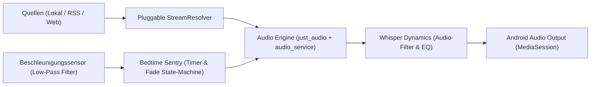

# Nocturne: Bedtime Audio Engine

Nocturne ist ein nativer Android-Medienplayer, der speziell für das Hören zum Einschlafen entwickelt wurde. Er vereint lokale Hörbücher, RSS-Podcasts und YouTube-Medien in einer gemeinsamen Einschlaf-Queue mit unterbrechungsfreier Hintergrundwiedergabe, intelligentem Sleep-Timer und dynamischer Audio-Pegelglättung.

---

## 1. Kern-Funktionen

### 🌙 Intelligente Bedtime-Suite
- **Shake-to-Reset:** Ein kurzes, sanftes Schütteln des Smartphones im Dunkeln verlängert den Timer um 15 Minuten. Bestätigung erfolgt über ein unauffälliges Vibrationssignal, ohne dass das Display aktiviert werden muss.
- **Logarithmischer Lautstärke-Fade-Out:** In den letzten 60 Sekunden des Countdowns sinkt die Lautstärke sanft ab, um ein abruptes Aufschrecken zu verhindern.
- **Auto-Rewind Kalibrierung:** Beim Fortsetzen am nächsten Tag springt die Wiedergabe automatisch exakt 45 Sekunden *vor* den Beginn des Fade-Outs zurück, um verpasste Passagen mühelos aufzuholen.
- **Whisper Dynamics (Nacht-Kompressor):** Echtzeit-Pegelanpassung gleicht laute Podcast-Intros, Musik-Einblendungen und Stimmspitzen an. Leise Dialoge bleiben auch bei minimaler Gesamtlautstärke (5-10%) verständlich.

### 🎧 Universelle Medienquellen (BYOM)
- **Lokale Hörbücher:** Unterstützung für `.m4b` (inklusive eingebetteter Kapitelmarken und Cover), `.mp3`, `.flac`, `.opus` und `.m4a`.
- **Offene RSS-Podcasts:** Direktes Abonnieren und Streamen regulärer Podcast-Feeds ohne Zwischenserver.
- **Web-Streams & YouTube:** Umschaltbar zwischen Audio-only (spart bis zu 90% Bandbreite und Akku) und Video-Modus. Offline-Download mit automatischer Tag-Erstellung.
- **Cross-Source Queue:** Mische ein YouTube-Video, eine Podcast-Folge und ein Hörbuch-Kapitel in einer fortlaufenden Nacht-Wiedergabeliste.

### 📁 Hybride Speicherverwaltung
- **Interne App-Sandbox:** Downloads aus Web-Quellen und Podcasts landen standardmäßig im isolierten App-Verzeichnis, geschützt vor versehentlicher Löschung.
- **Storage Access Framework (SAF):** Beliebige Ordner auf dem internen Speicher oder der SD-Karte können als Hörbuch-Quellen eingebunden werden.
- **Auto-Sortierung:** Chaotische Verzeichnisse können auf Wunsch nach ID3-Metadaten in eine saubere Struktur überführt werden:
  `/Audiobooks/<Autor>/<Buchname>/<Track> - <Titel>.<ext>`

---

## 2. Architektur & Tech-Stack

- **Plattform:** Flutter (Dart) mit strikter Clean Architecture. Die Business-Logik ist vollständig plattformunabhängig gekapselt und für Web/Desktop wiederverwendbar.
- **Audio-Pipeline:** `just_audio` + `audio_service` (Android `FOREGROUND_SERVICE_MEDIA_PLAYBACK` gegen Doze-Mode).
- **Extraktion:** `youtube_explode_dart` mit automatischem Fallback auf dezentrale Invidious/Piped-APIs.
- **Persistenz:** Lokale relationale SQLite-Datenbank via `drift`.

---

## 3. Installation & Updates

Da Nocturne freie Audio-Downloads unterstützt, erfolgt der Vertrieb außerhalb des Google Play Stores über offene Distributionskanäle:

### Option A: Automatisierte Updates mit Obtainium (Empfohlen)
1. Die Open-Source-App [Obtainium](https://github.com/ImranR98/Obtainium) auf dem Android-Gerät installieren.
2. In Obtainium auf *"Add App"* tippen und die URL dieses Repositories eintragen:
   `https://github.com/<user>/nocturne`
3. Obtainium installiert die passende APK (`arm64-v8a`) und benachrichtigt automatisch über Updates.

### Option B: Direkter APK-Download
Im Bereich [Releases](https://github.com/<user>/nocturne/releases) die aktuellste Version als APK herunterladen und auf dem Smartphone installieren.

---

## 4. Rechtlicher Hinweis (Compliance)

Nocturne versteht sich als neutrales Abspielwerkzeug nach dem Vorbild von VLC Media Player und NewPipe. Die Software enthält keine urheberrechtlich geschützten Werke, hostet keine Streams und umgeht keine wirksamen technischen Kopierschutzmaßnahmen (DRM). Die private Speicherung von Streams erfolgt im Rahmen der gesetzlichen Privatkopie (§ 53 dUrhG / § 42 öUrhG im DACH-Raum).

---

## 5. Lizenz

Dieses Projekt ist unter der **GNU General Public License v3 (GPLv3)** lizenziert. Siehe `LICENSE` für Details.

---

## 6. Weiterführende Dokumentation

- [Architektur-Spezifikation & Schichtenmodell](docs/architecture/ARCHITECTURE.md)
- [Rechtliche Einordnung (§ 53 dUrhG / § 42 öUrhG) & Distributions-Pipeline](docs/compliance/LEGAL_AND_DISTRIBUTION.md)
- [7-Dimensionen Loop-Controller Prüfbericht (10/10 Maximierung)](docs/reports/EVALUATION_REPORT.md)
- [Argon Hoch (Gemini 4 Web) System-Audit & Freigabe](docs/reports/ARGON_AUDIT_VERDICT.md)
