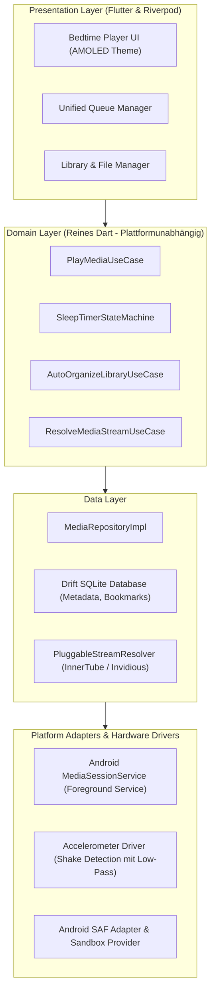
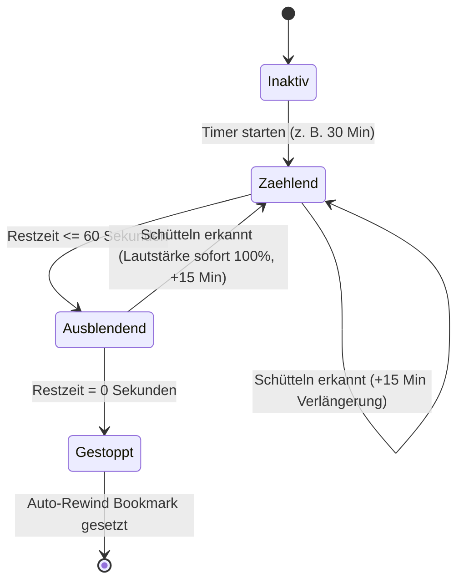
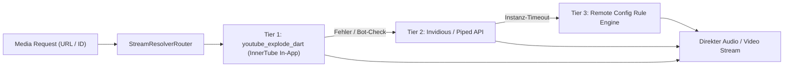

# Technische Architektur: Nocturne Bedtime Audio

Dieses Dokument beschreibt die Systemarchitektur, Datenflüsse und technischen Komponenten von Nocturne. Die Architektur basiert auf den Prinzipien der Clean Architecture (Trennung von Domain, Data und Presentation) und ermöglicht die spätere Portierung auf Web- und Desktop-Plattformen.

---

## 1. Systemübersicht & Schichtenmodell

---

## 2. Komponenten & Schichten

### 2.1 Presentation Layer (UI & State)
- **State-Management:** Flutter Riverpod für reaktive Zustände, Testbarkeit und vollständige Entkopplung der UI von der Geschäftslogik.
- **Bedtime-Interface:**
  - 100% Reines OLED-Schwarz (`#000000`) zur Reduktion von Lichtemissionen im Schlafzimmer.
  - Große, blendfreie Steuerelemente für mühelose Bedienung im Halbdunkel.
  - Touch-Sperre ("Bed Lock") gegen versehentliche Eingaben durch Bettdecken oder Kissen.

### 2.2 Domain Layer (Geschäftslogik)
- Enthält ausschließlich portable Dart-Klassen ohne Abhängigkeit zu `flutter/material.dart` oder nativen Android-Bibliotheken.
- **Wichtigste Use Cases:**
  - `ManageBedtimeSession`: Steuert Countdown, Schüttel-Events, Lautstärke-Fade und Lesezeichen-Erstellung.
  - `ResolveMediaStream`: Nimmt eine Medien-ID oder URL entgegen und wählt den besten Resolver.
  - `OrganizeAudioFolder`: Parst ID3-Tags unstrukturierter Dateien und ordnet sie in ein normiertes Schema (`Autor / Buch / Titel`).

### 2.3 Data Layer (Persistenz & Services)
- **Lokale Datenbank (`drift`):**
  - Schnelle relationale SQLite-Speicherung.
  - Tabellen: `media_items`, `playlists`, `playback_history`, `bookmarks`, `sleep_presets`.
  - Millisekunden-genaue Speicherung der Abspielpositionen für unterbrechungsfreies Fortsetzen.

### 2.4 Platform Layer (Treiber & Android Services)
- **Audio-Architektur:**
  - Basiert auf `audio_service` und `just_audio`.
  - Android Foreground Service (`FOREGROUND_SERVICE_MEDIA_PLAYBACK`) mit kontinuierlichem Audiofokus.
  - Verhindert das Einfrieren der Wiedergabe durch aggressive Hersteller-Energiesparmodi (Samsung, Xiaomi, Google Pixel Doze Mode).
- **Sensor-Signalverarbeitung:**
  - `sensors_plus` liest die X-, Y- und Z-Achsen des Beschleunigungssensors aus.
  - Ein Tiefpassfilter (Low-Pass Filter) filtert normale Schlaf- und Atembewegungen heraus.
  - Nur eine gezielte Schüttelbewegung (Schwelle: Beschleunigungsvektor > 12 m/s² mit Vorzeichenwechsel innerhalb von 600 ms) löst den Timer-Reset aus.
  - Kurzes, sanftes Vibrationsfeedback bestätigt den Reset, ohne den Raum mit Ton zu stören.

---

## 3. Die Bedtime Engine (Sleep-Timer State-Machine)

### Logik des Lautstärke-Fade-Outs
In den letzten 60 Sekunden sinkt die Lautstärke nicht linear, sondern logarithmisch gemäß menschlichem Hörempfinden:
$$Volume(t) = Volume_{start} \times \left(\frac{t_{rest}}{60}\right)^2$$
Sobald der Timer 0 erreicht:
1. Audio wird pausiert.
2. Der WakeLock wird freigegeben.
3. Der Beschleunigungssensor wird deaktiviert, um den Akku im Tiefschlaf nicht zu belasten.
4. Ein automatischer Bookmark wird exakt 45 Sekunden *vor* Beginn des Fade-Outs gespeichert.

---

## 4. Pluggable StreamResolver-Architektur

Um die App gegen Änderungen von Streaming-Plattformen abzusichern, ist die Extraktion modular aufgebaut:

- **Audio-Only Optimierung:** Wenn der Hörer den Bildschirm ausschaltet oder reines Audio wählt, lädt die Engine ausschließlich den Audiotrack (M4A/Opus mit 128-160 kbps). Das spart 85-90% Bandbreite und Akku gegenüber einem Video-Stream.
- **Offline Download Manager:** Getrennte Queues für Audio-Dateien und optionale Video-Downloads mit automatischer Tag-Injektion.

---

## 5. Speicher- & Ordner-Management (Hybrid Sandbox & SAF)

Nocturne nutzt eine duale Speicherstrategie:
1. **Interne Sandbox (`/data/user/0/com.nocturne.audio/files/`):**
   - Standard-Ablageort für alle In-App-Downloads (YouTube-Audio, Podcast-Episoden).
   - Vollständig geschützt vor Bereinigungs-Apps oder versehentlichem Löschen durch das System.
2. **Externer Ordner-Import (Storage Access Framework - SAF):**
   - Der Nutzer kann beliebige Ordner (z. B. auf SD-Karte oder im internen Speicher) verknüpfen.
   - Der `LibraryScanner` liest rekursiv alle gängigen Formate (`.mp3`, `.m4b`, `.m4a`, `.flac`, `.opus`) ein.
   - **Auto-Sortierung:** Dateien mit unvollständigen oder verstreuten Pfaden werden auf Wunsch analysiert und in eine saubere Struktur überführt:
     `/Audiobooks/<Autor>/<Buchname>/<Track-Nummer> - <Titel>.<ext>`
