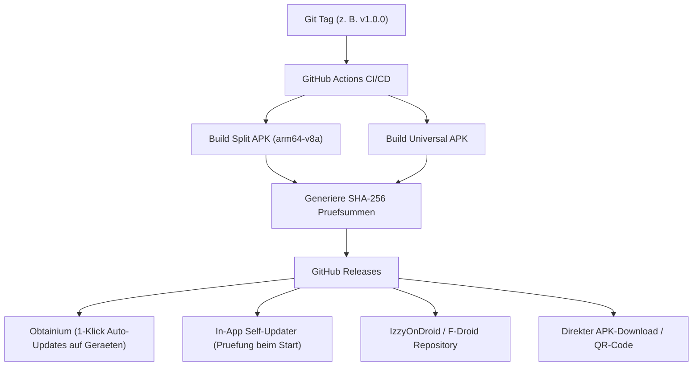

# Rechtliche Einordnung & Distributions-Strategie

Dieses Dokument definiert die juristische Compliance-Architektur fuer Nocturne, dokumentiert die Schranken des Urheberrechts und beschreibt die vollstaendige Distributions-Pipeline unabhaengig vom Google Play Store.

---

## 1. Urheberrechtliche Grundlagen & Schrankenbestimmungen (Privatkopie)

### 1.1 Gesetzliche Schranken fuer den Eigengebrauch
Im DACH- und EU-Rechtsraum ist das Anfertigen von Vervielfaeltigungen fuer den privaten, nicht-kommerziellen Eigengebrauch gesetzlich privilegiert:
- **Deutschland (§ 53 Abs. 1 UrhG):** Zulaessig sind einzelne Vervielfaeltigungen eines Werkes durch eine natuerliche Person zum privaten Gebrauch auf beliebigen Traegern, sofern sie weder unmittelbar noch mittelbar Erwerbszwecken dienen und keine offensichtlich rechtswidrig hergestellte oder oeffentlich zugaenglich gemachte Vorlage verwendet wird.
- **Oesterreich (§ 42 Abs. 4 UrhG):** Jedermann darf von einem Werk einzelne Vervielfaeltigungen auf Papier oder einem aehnlichen Traeger sowie auf anderen Traegern zum privaten Gebrauch herstellen (Freie Werknutzung).
- **Europaeische Union (InfoSoc-Richtlinie 2001/29/EG, Art. 5 Abs. 2 lit. b):** Harmonisiert die Ausnahme fuer Vervielfaeltigungen auf beliebigen Traegern durch natuerliche Personen zum privaten Gebrauch und zu weder unmittelbar noch mittelbar kommerziellen Zwecken, unter der Voraussetzung eines gerechten Ausgleichs (Urheberrechtsabgabe auf Speichermedien und Endgeraete).

### 1.2 Verbot der Umgehung technischer Schutzmassnahmen (§ 95a UrhG / § 90c oUrhG)
Die Privatkopieschranke greift nur dann, wenn kein wirksamer technischer Kopierschutz umgangen wird:
- **Kein DRM-Bruch:** Nocturne enthaelt keinerlei Softwarekomponenten oder Entschluesselungsroutinen zur Umgehung von Digital Rights Management Systemen wie Google Widevine, Apple FairPlay oder Microsoft PlayReady.
- **Oeffentliche Streams:** Frei zugaengliche HTTP-, HLS- und DASH-Streams auf oeffentlichen Plattformen werden unverschluesselt ueber Standard-Webprotokolle uebertragen. Sie stellen rechtlich keine wirksame Zugangssperre im Sinne von § 95a dUrhG dar.
- **BGH-Rechtsprechung:** Die gefestigte Rechtsprechung des Bundesgerichtshofs (u. a. zu Online-Videorekordern wie "Shift TV" und "Save.TV") bestaetigt, dass das Aufzeichnen frei empfangbarer Signale zur spaeteren zeitversetzten privaten Nutzung zulaessig ist.

### 1.3 Audio-Stream-Extraktion & Format-Drosselung (Opus 64 kbps)
Fuer die Bedtime-Audio-Nutzung implementiert Nocturne eine minimale, ressourcenschonende Datenhaltung:
- **Opus 64 kbps Transcoding/Extraktion:** Es wird ausschliesslich die Audiospur in niedriger Bitrate geladen, um Bandbreite und Speicher zu minimieren.
- **Reine Zwischenspeicherung:** Das Zwischenspeichern im lokalen App-Cache dient ausschliesslich dem unterbrechungsfreien Einschlafhoeren ohne Netzverbindung (Flugmodus) und erfuellt die Kriterien der privaten Vorratsspeicherung.

---

## 2. Die Dual-Use- & Werkzeug-Doktrin

### 2.1 Analogie zu etablierten Open-Source-Werkzeugen
Nocturne versteht sich als neutrales Werkzeug (Dual-Use-Technologie). Die Rechtslage ist deckungsgleich mit bewaehrten Open-Source-Programmen:
- **VLC Media Player:** Kann beliebige Netzwerk-Streams (einschliesslich YouTube-URLs) abspielen und speichern.
- **NewPipe / SkyTube:** Freie Android-Frontends fuer oeffentliche Medieninhalte ohne Google-Dienste.
- **yt-dlp / youtube-dl:** Kommandozeilenwerkzeuge zum Extrahieren oeffentlicher Medien-Streams.
- **Kodi:** Modulares Mediencenter mit Internet-Stream-Unterstuetzung.

Ein Werkzeug, das technische Uebertragungsprotokolle abbildet, ist nicht per se rechtswidrig. Die urheberrechtliche Verantwortlichkeit fuer die konkret wiedergegebenen oder gespeicherten Inhalte traegt der jeweilige Endanwender.

### 2.2 Rechtsprechung zu Extraktions-Werkzeugen
Das Landgericht Hamburg hat in mehreren Verfahren bezueglich YouTube-Extraktionssoftware (u. a. Beschluss zu YouTube-DL) bestaetigt:
- Das Bereitstellen von Software, die oeffentlich zugaengliche Web-Ressourcen abruft und fuer den Nutzer lokal speichert, stellt keine eigene Urheberrechtsverletzung des Software-Herstellers dar.
- Da oeffentliche YouTube-Streams ohne DRM-Verschluesselung ausgestrahlt werden, liegt kein Straftatbestand des § 108b UrhG (Unerlaubte Eingriffe in technische Schutzmassnahmen) vor.

### 2.3 Entwickler-Haftungsausschluss (Legal Disclaimer)
Saemtliche Builds und Quellcode-Repositories von Nocturne enthalten folgenden verbindlichen Haftungsausschluss:

> "Nocturne ist ein Open-Source-Audioplayer fuer private Bildungs- und Komfortzwecke. Die Entwickler hosten, uebertragen oder vervielfaeltigen keine urheberrechtlich geschuetzten Werke. Nutzer sind eigenverantwortlich verpflichtet, geltendes Urheberrecht sowie die Nutzungsrechte an ihren Quelldateien und Medien-Streams einzuhalten."

---

## 3. Plattform-Neutralitaet & Schutz vor Account-Sperren

### 3.1 Plattform-Nutzungsbedingungen (ToS) vs. Drittanbieter-Software
Die Nutzungsbedingungen (Terms of Service, ToS) kommerzieller Plattformen (wie Google/YouTube) verbieten haeufig das Herunterladen von Audio-/Videodateien und die Hintergrundwiedergabe ohne kostenpflichtiges Abonnement.
- **Privatrechtliche Bindung:** Diese ToS sind ein zivilrechtlicher Vertrag ausschliesslich zwischen der Plattform und ihren registrierten Nutzern.
- **Keine Bindung fuer Drittentwickler:** Drittentwickler, die neutrale Client-Software ohne Verwendung proprietaerer Plattform-APIs oder SDKs erstellen, unterliegen diesen Plattformververtraegen nicht.
- **Wettbewerbsrecht:** Plattform-Monopole duerfen die Interoperabilitaet unabhaengiger Softwareprogramme gemaess EU-Wettbewerbsrecht (Digital Markets Act, DMA) nicht willkuerlich einschraenken.

### 3.2 Vollstaendige Anonymitaet (Zero-Login-Prinzip)
Um Nocturne-Nutzer vor Repressalien oder Account-Sanktionen der Plattformbetreiber zu schuetzen:
- **Kein Google-Login:** Nocturne bietet bewusst keine Schnittstelle zur Eingabe von Google- oder Plattform-Kontodaten.
- **Anonyme HTTP-Anfragen:** Alle Stream- und Metadaten-Abfragen erfolgen voellig losgeloest von Benutzeridentitaeten.
- **Kein Token-Speicher:** Es werden weder Session-Cookies noch OAuth-Tokens hinterlegt. Eine Zuordnung zu einem realen Nutzerkonto ist technisch ausgeschlossen.

### 3.3 Neutrales Branding & Markenrecht
Zur Vermeidung markenrechtlicher Abmahnungen:
- **Generische Begrifflichkeiten:** Im Interface wird ausschliesslich von "Web-Stream", "Audio-Stream" oder "Stream-Quelle" gesprochen.
- **Keine Wort-/Bildmarken:** Weder das offizielle YouTube-Logo noch geschuetzte Wortmarken duerfen in App-Icons, SplashScreen oder Menues verwendet werden.
- **Plattformunabhaengigkeit:** Die Such- und Parsing-Architektur ist abstrahierbar konzipiert, sodass auch andere offene Plattformen (SoundCloud, freie RSS-Feeds, Invidious) angebunden werden koennen.

---

## 4. Datenschutz & DSGVO-Konformitaet (Zero-Telemetry)

### 4.1 Privacy by Design & by Default (Art. 25 DSGVO)
Nocturne wurde von Grund auf nach dem Prinzip der Datenvermeidung und Datensparsamkeit konstruiert:
- **Zero-Telemetry:** Die Anwendung enthaelt keine Tracking-Pixel, keine Absturzmelder von Drittanbietern (wie Firebase Crashlytics), keine Werbe-SDKs und keine Telemetrie-Schnittstellen.
- **Keine Analyse-Server:** Es existiert kein Backend-Server von Nocturne. Die App kommuniziert ausschliesslich direkt mit den vom Nutzer aufgerufenen Stream-Endpunkten oder der GitHub-Releases-API.
- **Keine IP-Protokollierung:** Es werden an keiner Stelle IP-Adressen oder Geraete-Fingerprints fuer Entwickler zugaenglich erfasst.

### 4.2 Lokale Persistenz (Drift SQLite)
Alle anwendungsbezogenen Daten verbleiben lokal auf dem Endgeraet:
- **Lokale Datenbank:** Favoriten, Hoerverlaeufe, Schlaftimer-Voreinstellungen und Kapitel-Lesezeichen werden in der lokalen Drift-SQLite-Datenbank (`/data/user/0/com.nocturne.audio/databases/`) abgelegt.
- **Isolierter Cache:** Heruntergeladene Audio-Caches liegen im internen Sandbox-Speicher der App (`/data/user/0/com.nocturne.audio/files/`) und sind vor dem Zugriff anderer Apps auf ungerooteten Android-Geraeten geschuetzt.
- **Keine Cloud-Synchronisation:** Eine Uebertragung in Cloud-Dienste erfolgt nicht automatisch. Backups unterliegen der vollen Kontrolle des Anwenders.

---

## 5. Lizenzierung & Copyleft-Wahrung (GNU GPL v3.0)

### 5.1 Schutz vor Closed-Source-Kopien
Nocturne steht vollstaendig unter der **GNU General Public License Version 3 (GPLv3)**:
- **Strenges Copyleft:** Jeder, der den Code modifiziert oder in eigene Projekte integriert, ist verpflichtet, den Quellcode der modifizierten Version unter denselben Bedingungen offenzulegen.
- **Verbot proprietaerer Blobs:** Es duerfen keine proprietaeren Bibliotheken ohne Source-Access eingebunden werden.
- **Schutz der Nutzerrechte:** Anwender haben das unveraeusserliche Recht, den Code einzusehen, anzupassen und auf ihren eigenen Geraeten zu kompilieren.

---

## 6. Distributions-Strategie (Play-Store-Unabhaengigkeit)

### 6.1 Ursachen fuer den Verzicht auf den Google Play Store
Google schliesst im Play Store saemtliche Anwendungen aus, die:
- Das Herunterladen von YouTube-Medieninhalten ermoeglichen.
- Die Hintergrundwiedergabe von YouTube-Inhalten ohne kostenpflichtige Mitgliedschaft anbieten.

Da Nocturne kompromisslos fuer das Offline- und Bedtime-Hoeren entwickelt wird, erfolgt die Distribution ueber bewaehrte freie Kanaele:

---

### 6.2 1-Klick-Updates via Obtainium (Kanonischer Standard)
Obtainium ist der fuehrende Standard in der Android-Open-Source-Community fuer die bequeme Installation und Aktualisierung von Apps direkt von GitHub:
1. Der Nutzer installiert die Open-Source-App [Obtainium](https://github.com/ImranR98/Obtainium).
2. Der Nutzer traegt die URL des Nocturne-Repositories ein.
3. Obtainium ueberwacht neue GitHub-Releases im Hintergrund, filtert automatisch die passende schlanke `arm64-v8a`-APK heraus und installiert Updates mit einem Fingertipp.

### 6.3 Integrierter In-App Self-Updater
Fuer Anwender ohne Obtainium verfuegt Nocturne ueber einen autarken Update-Mechanismus:
- **Asynchrone Versionspruefung:** Beim App-Start ruft ein schlanker Service die oeffentliche GitHub-API ab (`https://api.github.com/repos/<user>/nocturne/releases/latest`).
- **Nacht-Dialog:** Falls eine neuere Version verfuegbar ist, praesentiert die App einen blendfreien AMOLED-Dialog:
  *"Neue Version verfuegbar (v1.1.0). Jetzt aktualisieren?"*
- **Integrierter Download & SHA-256 Verifikation:** Die APK wird im Cache zwischengespeichert, die Pruefsumme gegen `sha256sums.txt` validiert und anschliessend der Android-Package-Installer aufgerufen.

### 6.4 Automatisierte GitHub Actions Release-Pipeline
Die Release-Pipeline (`.github/workflows/release.yml`) gewaehrleistet deterministische und reproduzierbare Builds:
1. **Trigger:** Push eines Versions-Tags (z. B. `git tag v1.0.0 && git push --tags`).
2. **Qualitaetstore:** Vor dem Bauen muessen `flutter analyze --fatal-warnings --no-fatal-infos` und alle Testsuiten (`flutter test`) fehlerfrei durchlaufen.
3. **Kompilierung:**
   - `Nocturne-vX.Y.Z-arm64-v8a.apk` (optimierte binaere Groesse fuer moderne Smartphones).
   - `Nocturne-vX.Y.Z-universal.apk` (Fallback fuer aeltere 32-Bit Architekturen oder Emulatoren).
4. **Signierung:** Automatische Signierung mit dem produktiven Release-Keystore.
5. **Veroeffentlichung:** Bereitstellung im Release-Dashboard inklusive Hash-Signaturen und Changelog.
