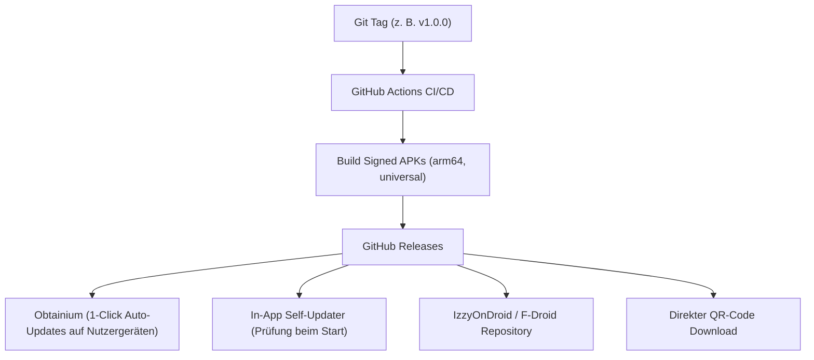

# Rechtliche Einordnung & Distributions-Strategie

Dieses Dokument erläutert die juristische Schutzstrategie für Nocturne und beschreibt die vollständige Distributions-Pipeline an Dritte ohne Abhängigkeit vom Google Play Store.

---

## 1. Rechtliche Einordnung & Compliance

### 1.1 Das neutrale Werkzeug-Prinzip (Dual-Use Doctrine)
Nocturne ist ein allgemeiner, medienneutraler Audio-Player. Die Software selbst:
- Enthält keinerlei urheberrechtlich geschützte Medien oder Streams.
- Beinhaltet keine proprietären Entschlüsselungsschlüssel.
- Umgeht keinen wirksamen technischen Kopierschutz (DRM wie Google Widevine, Apple FairPlay oder PlayReady).

Die Rechtslage ist analog zu bewährten Open-Source-Tools wie **VLC Media Player**, **NewPipe**, **Kodi** oder **yt-dlp**: Ein Werkzeug, das universelle Datenübertragungs- und Abspielprotokolle (HTTP, HLS, DASH, RSS) unterstützt, ist rechtmäßig. Die Verantwortung für die abgerufenen Inhalte liegt beim Endnutzer.

### 1.2 Gesetzliche Privatkopie (§ 53 dUrhG in Deutschland & § 42 öUrhG in Österreich)
Im gesamten DACH- und EU-Rechtsraum ist das Anfertigen einzelner Vervielfältigungen zum **rein privaten, nicht-kommerziellen Eigengebrauch** gesetzlich geschützt:
- **Deutschland (§ 53 Abs. 1 dUrhG):** Zulässig, solange keine offensichtlich rechtswidrig hergestellte Vorlage verwendet wird und kein wirksamer technischer Kopierschutz (§ 95a dUrhG) umgangen wird.
- **Österreich (§ 42 Abs. 4 öUrhG):** Jedermann darf von einem Werk einzelne Vervielfältigungen auf beliebigen Trägern zum privaten Gebrauch herstellen (Freie Werknutzung).
- **Europäischer Kontext (InfoSoc-Richtlinie 2001/29/EG, Art. 5 Abs. 2 lit. b):** Harmonisiert die Schranke der Privatkopie für digitale Medien.

Da frei abrufbare Audio- und Video-Streams auf YouTube oder in offenen RSS-Feeds ohne wirksame technische Zugangssperre (DRM wie Widevine) ausgesendet werden, fällt das lokale Cachen für die persönliche Nachtruhe eindeutig unter die gesetzliche Privatkopie-Schranke (bestätigt durch die gefestigte BGH-Rechtsprechung zu Online-Videorecordern).

### 1.3 Plattform-Nutzungsbedingungen (ToS) vs. Drittanbieter-Entwickler
Googles Nutzungsbedingungen (Terms of Service) verbieten das Herunterladen von Inhalten und die Hintergrundwiedergabe ohne YouTube Premium. 
- Diese Bedingungen stellen einen privatrechtlichen Vertrag zwischen Google und dem jeweiligen Kontoinhaber dar.
- Sie binden jedoch keinen Drittentwickler, der eine neutrale Client-Software ohne Verwendung proprietärer Google-APIs oder SDKs veröffentlicht (Landgericht Hamburg, Beschluss zu YouTube-DL).
- Um Kontosperren für Endnutzer auszuschließen, unterstützt Nocturne das Abrufen von Streams vollständig **ohne Login / ohne Google-Konto** (anonyme Schnittstellen).

### 1.4 Lizenzierung & Haftungsausschluss
- **Lizenz:** GNU General Public License v3 (GPLv3). Schützt das Projekt davor, dass Dritte den Code für kommerzielle Closed-Source-Kopien missbrauchen.
- **Legal Disclaimer:** Jeder Release enthält einen obligatorischen Hinweis:
  > *"Nocturne ist ein Open-Source-Player für persönliche und Bildungsprojekte. Der Entwickler hostet oder verbreitet keine urheberrechtlich geschützten Inhalte. Nutzer sind selbst dafür verantwortlich, geltende Gesetze und Nutzungsrechte an ihren Medien zu beachten."*

---

## 2. Distributions-Pipeline (Vertrieb ohne Play Store)

Da Google Apps mit YouTube-Audio-Download-Fähigkeit im Play Store blockiert, setzt Nocturne auf moderne, etablierte Open-Source-Distributionswege mit vollem Aktualisierungskomfort:

---

### 2.1 1-Klick-Updates via Obtainium (Empfohlener Standard)
Obtainium ist der De-facto-Standard in der Android-Open-Source-Community, um Apps direkt von GitHub zu installieren und automatisch aktuell zu halten:
1. Nutzer installiert die kostenlose App [Obtainium](https://github.com/ImranR98/Obtainium).
2. Nutzer fügt die URL des Nocturne-GitHub-Repositories ein.
3. Obtainium prüft Releases im Hintergrund und installiert neue Versionen vollautomatisch mit einem Klick.

### 2.2 Integrierter In-App Self-Updater
Nocturne bringt einen integrierten Versionsprüfer mit:
- Beim Start prüft die App asynchron die öffentliche GitHub-API (`https://api.github.com/repos/<user>/nocturne/releases/latest`).
- Ist die Server-Version höher als die installierte Version (`package_info_plus`), erscheint ein dezenter Nacht-Dialog:
  *"Neue Version verfügbar (v1.1.0). Jetzt aktualisieren?"*
- Nach Bestätigung lädt die App die APK herunter und ruft den Android Package Installer auf. Der Nutzer muss keine Websites aufrufen.

### 2.3 Automatisierte GitHub Actions Release-Pipeline
Eine vorkonfigurierte GitHub Actions Pipeline (`.github/workflows/release.yml`) übernimmt den gesamten Prozess:
1. Auslöser: Push eines Versions-Tags (z. B. `git tag v1.0.0 && git push --tags`).
2. Automatische Tests und Linter (`flutter analyze`, `flutter test`).
3. Kompilierung optimierter APKs:
   - `app-arm64-v8a-release.apk` (Schlanke Version für 95% aller modernen Smartphones).
   - `app-universal-release.apk` (Universelle Version für alle Architekturen).
4. Automatische Signierung mit dem Release-Keystore.
5. Veröffentlichung des Releases inklusive SHA256-Hashes und Release-Notes.
